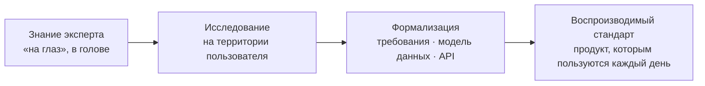

## Полина Немечкина · системный аналитик · медицинские ИТ

Превращаю экспертное знание, которое делается «на глаз» или держится в голове специалиста, в воспроизводимый стандарт и продукт.

Бэкграунд fullstack-разработки 2+ года: требования пишу так, чтобы у разработки не оставалось лишних вопросов, а в чужом коде и схемах БД разбираюсь сама.

---

### Проекты

| Проект | Что это | Результат |
|---|---|---|
| **FluidCare** · *приватный* | ПО для расчёта водного баланса пациентов реанимации. Прошла путь от опроса врачей до внедрения | Используется врачами отделения каждый день · свидетельство о регистрации программы для ЭВМ № 2026617585 |
| **Medical Nutrition** · *приватный, в разработке* | Мобильное приложение для нутритивного сопровождения пациентов в критическом состоянии. Клиническую модель формализую вместе с врачом анестезиологом-реаниматологом | Формулы энергозатрат и шкалы скрининга проходят проверку врачом по клиническим рекомендациям |
| **Платформа подготовки к экзамену ПДД** · *приватный* | Продукт с нуля: концепция, архитектура, поэтапный план, MVP-бэкенд, инфраструктура команды | MVP на FastAPI + PostgreSQL в Docker, YouTrack и Gitea связаны в один процесс |
| **Корпоративные порталы** · *СИБИНТЕК* | Enterprise-системы от 2 000 пользователей: требования → ТЗ → разработка → внедрение | Нашла причину частых обращений и устранила её: обращений по проблеме стало меньше примерно на 86% |

<!-- Когда опубликуешь репозитории, раскомментируй этот блок:
**Открытые кейсы:**
- [fluidcare-case](https://github.com/qpollig/fluidcare-case): как проблема врачей превратилась в работающую систему. Исследование, BPMN, доменная модель, ER, требования, ADR
- [brewlab](https://github.com/qpollig/brewlab): spec-first проект по стандартизации кофейных рецептов. DDD, BPMN, OpenAPI + JSON Schema, PostgreSQL, SQL-аналитика
-->

---

### Инструменты

**Анализ и проектирование:** требования · ТЗ · REST API / OpenAPI · JSON Schema (Pydantic) · модели данных · техническая документация
**Данные:** SQL · PostgreSQL · MS SQL · проектирование БД · миграции
**Разработка:** Python (FastAPI, Pydantic, Django) · C# / .NET · TypeScript / Vue
**Инфраструктура:** Docker · Linux · Git · YouTrack

---

### Вне работы

Бывший бариста-наставник: сама готовлю кофе и разбираюсь в нём. Акробатика, сноуборд и беговые лыжи.

---

📬 [Telegram](https://t.me/nemechkina) · [Хабр Карьера](https://career.habr.com/qpollig) · qpollig@mail.ru · Челябинск, удалённо
